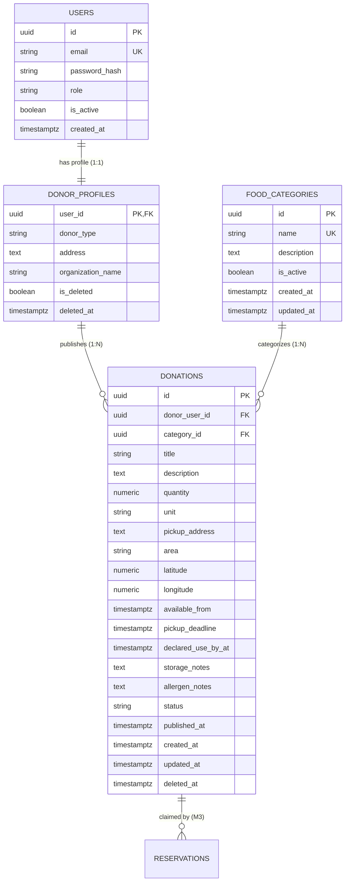

# M2 Data Model Specification: Donor & Donation Catalogue

## 1. Overview and Scope

This document specifies the relational data model for **Member 2 (M2): Donor & Donation Catalogue** of the FoodBridge REST API.

The FoodBridge platform coordinates the rescue of surplus food between donors, NGOs, and volunteers. Member 2 owns:
- The **Food Categories** catalogue.
- The **Donations** core entity and lifecycle state tracking.
- The **Donor Profiles** extension table linked to the shared `users` table.

All tables are designed for **PostgreSQL 16+** using **TypeORM** conventions.

---

## 2. Global Architectural Conventions

| Aspect | Standard | Justification |
|---|---|---|
| **Primary Keys** | UUID v4 (`uuid_generate_v4()` or `gen_random_uuid()`) | Prevents ID enumeration attacks, decouples ID generation from database round-trips, and ensures distributed uniqueness. |
| **Timestamps** | `timestamptz` (Timestamp with Time Zone) | Stored in UTC. Protects against Daylight Saving and server timezone drift. API serialization uses ISO 8601 strings with timezone offsets. |
| **Quantities** | `numeric(10,2)` | Avoids binary floating-point rounding errors. Stored with fixed 2-decimal scale; serialized as strings in JSON payloads. |
| **Audit Columns** | `created_at`, `updated_at`, `deleted_at` | Provides temporal traceability for administrative audits and university evaluation. |
| **Soft Deletion** | `is_deleted` (boolean) + `deleted_at` (timestamptz) | Retains referential integrity and historical accountability; prevents foreign key breaks on historical claims. |

---

## 3. Entity Definitions & Schema Specifications

### 3.1. DONOR_PROFILES Table

The `donor_profiles` table holds donor-specific business metadata. The core authentication credentials and role assignments live exclusively in the shared `users` table owned by Member 1.

> **Team Confirmation**: As agreed by the team, donor metadata is stored in `donor_profiles` rather than a unified organizations table. No duplicate user, password, or login entity is introduced here.

#### Columns and Constraints

| Column Name | PostgreSQL Type | Nullable | Default | Description & Constraints |
|---|---|---|---|---|
| `user_id` | `UUID` | No | None | Foreign Key referencing `users(id)` ON DELETE RESTRICT. Proposed Primary Key (see Decision D1). |
| `donor_type` | `VARCHAR(30)` | No | None | Enum: `'Individual'`, `'Restaurant'`, `'Business'`. Enforced via CHECK constraint. |
| `address` | `TEXT` | No | None | Physical operating address or headquarters of the donor. |
| `organization_name` | `VARCHAR(255)` | Yes | `NULL` | Legal or trade business name. Optional for `Individual`, required for `Restaurant` / `Business`. |
| `is_deleted` | `BOOLEAN` | No | `false` | Soft deletion status flag. |
| `deleted_at` | `TIMESTAMPTZ` | Yes | `NULL` | Soft deletion timestamp. Populated when `is_deleted` becomes `true`. |

#### Decisions Requiring Teammate Approval

> **[PENDING TEAM APPROVAL - DECISION D1: DONOR_PROFILES Primary Key Strategy]**
> - **Option A (Recommended)**: Use `user_id` as **both Primary Key and Foreign Key** (`user_id UUID PRIMARY KEY REFERENCES users(id)`). This guarantees a strict 1:1 database-level relation, eliminates a redundant UUID surrogate key, and speeds up joins.
> - **Option B**: Introduce a surrogate `id UUID PRIMARY KEY DEFAULT gen_random_uuid()`, and keep `user_id UUID NOT NULL UNIQUE REFERENCES users(id)`.
> - *Action Item for M1 & M2*: Confirm whether M1 prefers Option A or Option B for entity mapping.

---

### 3.2. FOOD_CATEGORIES Table

The `food_categories` table maintains the standardized classification of surplus food items (e.g., Cooked Meals, Bakery, Fresh Produce, Packaged Goods).

#### Columns and Constraints

| Column Name | PostgreSQL Type | Nullable | Default | Description & Constraints |
|---|---|---|---|---|
| `id` | `UUID` | No | `gen_random_uuid()` | Primary Key. |
| `name` | `VARCHAR(100)` | No | None | Category name. Case-insensitive unique index (`UNIQUE (LOWER(name))`). |
| `description` | `TEXT` | Yes | `NULL` | Detailed description, safe handling rules, or packaging guidelines. |
| `is_active` | `BOOLEAN` | No | `true` | Active status flag. Inactive categories cannot be selected for new donations. |
| `created_at` | `TIMESTAMPTZ` | No | `CURRENT_TIMESTAMP` | Timestamp when the record was inserted. |
| `updated_at` | `TIMESTAMPTZ` | No | `CURRENT_TIMESTAMP` | Timestamp when the record was last modified. |

#### Constraints & Indexes
- `uq_food_categories_name_lower`: Unique index on `LOWER(name)`.
- `idx_food_categories_is_active`: B-tree index on `is_active` for filtering.
- Deletion Constraint: Deletion of a category is rejected (`409 Conflict` / `ON DELETE RESTRICT`) if any historical or active donation references it. Deactivation via `is_active = false` is the safe lifecycle operation.

---

### 3.3. DONATIONS Table

The `donations` table is the core transactional entity for M2. It records surplus food listings, volume, physical pickup locations, time windows, safe storage requirements, and lifecycle status.

#### Columns and Constraints

| Column Name | PostgreSQL Type | Nullable | Default | Description & Constraints |
|---|---|---|---|---|
| `id` | `UUID` | No | `gen_random_uuid()` | Primary Key. |
| `donor_user_id` | `UUID` | No | None | Foreign key linking the donation to the owning donor. (See Decision D2). |
| `category_id` | `UUID` | No | None | Foreign Key referencing `food_categories(id)` ON DELETE RESTRICT. |
| `title` | `VARCHAR(150)` | No | None | Summary title of the food lot (min 3 chars, max 150 chars). |
| `description` | `TEXT` | Yes | `NULL` | Detailed breakdown of items, packaging, or handling notes. |
| `quantity` | `NUMERIC(10,2)` | No | None | Donated quantity. Must be strictly positive (`CHECK (quantity > 0)`). |
| `unit` | `VARCHAR(20)` | No | None | Enum: `'MEALS'`, `'BOXES'`, `'KG'`, `'LITRES'`. Enforced via CHECK constraint. |
| `pickup_address` | `TEXT` | No | None | Exact pickup location / dispatch counter snapshot. |
| `area` | `VARCHAR(100)` | No | None | Neighborhood or district identifier (e.g., 'Dhanmondi', 'Gulshan', 'Mirpur'). |
| `latitude` | `NUMERIC(9,6)` | Yes | `NULL` | GPS latitude. Range: `[-90.000000, 90.000000]`. |
| `longitude` | `NUMERIC(9,6)` | Yes | `NULL` | GPS longitude. Range: `[-180.000000, 180.000000]`. |
| `available_from` | `TIMESTAMPTZ` | No | None | Earliest time the food is packaged and ready for collection. |
| `pickup_deadline` | `TIMESTAMPTZ` | No | None | Hard cutoff time by which collection must occur. |
| `declared_use_by_at` | `TIMESTAMPTZ` | No | None | Food safety expiration timestamp declared by the donor. |
| `storage_notes` | `TEXT` | Yes | `NULL` | Specific thermal or handling requirements (e.g., 'Keep below 4C', 'Insulated box required'). |
| `allergen_notes` | `TEXT` | Yes | `NULL` | Food allergen warnings (e.g., 'Contains peanuts, dairy, gluten'). |
| `status` | `VARCHAR(30)` | No | `'DRAFT'` | Enum: `'DRAFT'`, `'AVAILABLE'`, `'RESERVED'`, `'PICKED_UP'`, `'DELIVERED'`, `'CANCELLED'`, `'EXPIRED'`, `'FAILED'`. |
| `published_at` | `TIMESTAMPTZ` | Yes | `NULL` | Instant when the donor moved the listing from `DRAFT` to `AVAILABLE`. |
| `created_at` | `TIMESTAMPTZ` | No | `CURRENT_TIMESTAMP` | Initial draft creation timestamp. |
| `updated_at` | `TIMESTAMPTZ` | No | `CURRENT_TIMESTAMP` | Last update timestamp. |
| `deleted_at` | `TIMESTAMPTZ` | Yes | `NULL` | Soft deletion timestamp for archiving unreserved drafts/listings. |

#### Decisions Requiring Teammate Approval

> **[PENDING TEAM APPROVAL - DECISION D2: Foreign Key Target for donor_user_id]**
> - **Option A (Recommended)**: `donor_user_id` references `donor_profiles(user_id)` directly (`ON DELETE RESTRICT`). This enforces at the database level that only users who have an active row in `donor_profiles` can create and own donations.
> - **Option B**: `donor_user_id` references `users(id)`, with application-level service checks verifying that the user has the `DONOR` role and an active profile.
> - *Action Item for M1 & M2*: Confirm foreign key target before finalizing migration scripts.

---

## 4. Business Invariants & Cross-Field Constraints

1. **Ownership Derivation Rule**:
   - `donor_user_id` is **never accepted from the client request body**.
   - It is extracted strictly from the validated JWT token (`req.user.id`) inside the controller and passed to the domain service.

2. **Time Window Sequence Rule**:
   - Enforced by database check constraint and DTO validation:
     $$\text{available\_from} < \text{pickup\_deadline} \le \text{declared\_use\_by\_at}$$
   - Both `pickup_deadline` and `declared_use_by_at` must be future timestamps relative to the database clock at creation/publishing.

3. **Quantity and Unit Scale Rules**:
   - `quantity > 0` always.
   - When `unit IN ('MEALS', 'BOXES')`: Quantity must be an integer (scale = 0, e.g., `10`, `35`). Fractional boxes or meals are rejected.
   - When `unit IN ('KG', 'LITRES')`: Quantity allows at most two decimal places (e.g., `12.50`, `3.75`).
   - Different units can never be summed into a single scalar value.

4. **Draft vs. Publishing Completeness Rule**:
   - **Creating a DRAFT**: Requires only a non-empty `title`. Partial fields are accepted so donors can save progress.
   - **Publishing (`POST /donations/:id/publish`)**: Requires complete validation of `category_id`, `quantity`, `unit`, `pickup_address`, `area`, `available_from`, `pickup_deadline`, and `declared_use_by_at`. If any mandatory field is missing, publishing fails with `400 Bad Request`.

5. **Immutability Once Reserved**:
   - Once a donation transitions to `RESERVED`, key collection terms (`quantity`, `unit`, `pickup_address`, `category_id`, and deadlines) are **immutable**. A donor cannot edit these terms under an active reservation.

---

## 5. Entity-Relationship Diagram (ERD)



---

## 6. PostgreSQL DDL Specification

```sql
-- Extensions
CREATE EXTENSION IF NOT EXISTS "uuid-ossp";

-- 1. FOOD_CATEGORIES TABLE
CREATE TABLE food_categories (
    id UUID PRIMARY KEY DEFAULT gen_random_uuid(),
    name VARCHAR(100) NOT NULL,
    description TEXT NULL,
    is_active BOOLEAN NOT NULL DEFAULT true,
    created_at TIMESTAMPTZ NOT NULL DEFAULT CURRENT_TIMESTAMP,
    updated_at TIMESTAMPTZ NOT NULL DEFAULT CURRENT_TIMESTAMP
);

CREATE UNIQUE INDEX uq_food_categories_name_lower 
ON food_categories (LOWER(name));

CREATE INDEX idx_food_categories_is_active 
ON food_categories (is_active);

-- 2. DONOR_PROFILES TABLE (Referencing M1 USERS)
-- Assumes users table created by M1: users(id UUID PRIMARY KEY, ...)
CREATE TABLE donor_profiles (
    user_id UUID PRIMARY KEY,
    donor_type VARCHAR(30) NOT NULL,
    address TEXT NOT NULL,
    organization_name VARCHAR(255) NULL,
    is_deleted BOOLEAN NOT NULL DEFAULT false,
    deleted_at TIMESTAMPTZ NULL,
    CONSTRAINT fk_donor_profiles_user 
        FOREIGN KEY (user_id) REFERENCES users(id) ON DELETE RESTRICT,
    CONSTRAINT chk_donor_profiles_type 
        CHECK (donor_type IN ('Individual', 'Restaurant', 'Business'))
);

CREATE INDEX idx_donor_profiles_is_deleted 
ON donor_profiles (is_deleted);

-- 3. DONATIONS TABLE
CREATE TABLE donations (
    id UUID PRIMARY KEY DEFAULT gen_random_uuid(),
    donor_user_id UUID NOT NULL,
    category_id UUID NOT NULL,
    title VARCHAR(150) NOT NULL,
    description TEXT NULL,
    quantity NUMERIC(10,2) NOT NULL,
    unit VARCHAR(20) NOT NULL,
    pickup_address TEXT NOT NULL,
    area VARCHAR(100) NOT NULL,
    latitude NUMERIC(9,6) NULL,
    longitude NUMERIC(9,6) NULL,
    available_from TIMESTAMPTZ NOT NULL,
    pickup_deadline TIMESTAMPTZ NOT NULL,
    declared_use_by_at TIMESTAMPTZ NOT NULL,
    storage_notes TEXT NULL,
    allergen_notes TEXT NULL,
    status VARCHAR(30) NOT NULL DEFAULT 'DRAFT',
    published_at TIMESTAMPTZ NULL,
    created_at TIMESTAMPTZ NOT NULL DEFAULT CURRENT_TIMESTAMP,
    updated_at TIMESTAMPTZ NOT NULL DEFAULT CURRENT_TIMESTAMP,
    deleted_at TIMESTAMPTZ NULL,
    
    -- Constraints
    CONSTRAINT fk_donations_donor 
        FOREIGN KEY (donor_user_id) REFERENCES donor_profiles(user_id) ON DELETE RESTRICT,
    CONSTRAINT fk_donations_category 
        FOREIGN KEY (category_id) REFERENCES food_categories(id) ON DELETE RESTRICT,
    CONSTRAINT chk_donations_quantity_positive 
        CHECK (quantity > 0),
    CONSTRAINT chk_donations_unit_valid 
        CHECK (unit IN ('MEALS', 'BOXES', 'KG', 'LITRES')),
    CONSTRAINT chk_donations_status_valid 
        CHECK (status IN ('DRAFT', 'AVAILABLE', 'RESERVED', 'PICKED_UP', 'DELIVERED', 'CANCELLED', 'EXPIRED', 'FAILED')),
    CONSTRAINT chk_donations_timeline_order 
        CHECK (available_from < pickup_deadline AND pickup_deadline <= declared_use_by_at),
    CONSTRAINT chk_donations_coordinates 
        CHECK (
            (latitude IS NULL OR (latitude >= -90.0 AND latitude <= 90.0)) AND
            (longitude IS NULL OR (longitude >= -180.0 AND longitude <= 180.0))
        )
);

-- Strategic Indexes
CREATE INDEX idx_donations_status_deadline 
ON donations (status, pickup_deadline) 
WHERE deleted_at IS NULL;

CREATE INDEX idx_donations_donor_created 
ON donations (donor_user_id, created_at DESC) 
WHERE deleted_at IS NULL;

CREATE INDEX idx_donations_area_category 
ON donations (area, category_id) 
WHERE status = 'AVAILABLE' AND deleted_at IS NULL;

CREATE INDEX idx_donations_deleted_at 
ON donations (deleted_at);
```

---

## 7. Summary of Decisions Requiring Team Approval

| ID | Topic | Options | Proposed Recommendation | Impacted Teammates |
|---|---|---|---|---|
| **D1** | `DONOR_PROFILES` Primary Key | Option A: `user_id` as PK/FK<br>Option B: Surrogate `id UUID` + Unique `user_id` | **Option A**: Strict 1:1, cleaner joins, zero redundant index overhead. | M1 (Admin/Auth), M2 |
| **D2** | `DONATIONS.donor_user_id` FK Target | Option A: References `donor_profiles(user_id)`<br>Option B: References `users(id)` | **Option A**: Database-enforced role consistency (prevents non-donors from owning donations). | M1, M2 |
| **D3** | Unit Scale Enforcement | Option A: Application DTO validation only<br>Option B: PostgreSQL trigger/CHECK constraint checking `scale` | **Option A**: Keep database constraint general (`numeric > 0`), enforce unit-to-scale rules strictly via class-validator DTOs. | M2, M3 |

