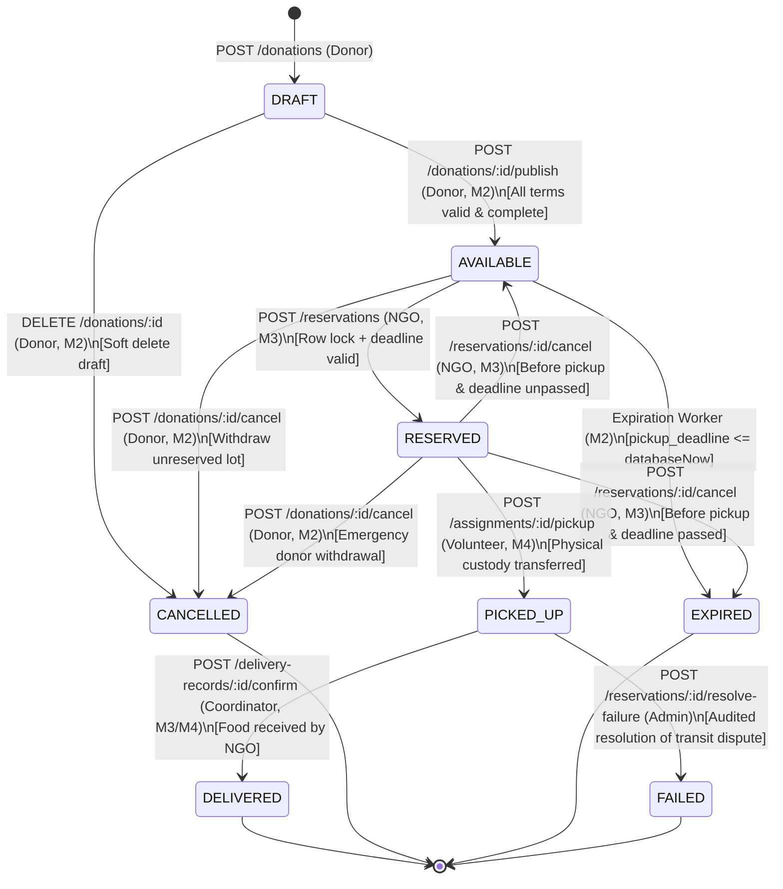

# M2 State Machine Specification: Donation Lifecycle

## 1. Overview and Core Philosophy

In the FoodBridge architecture, surplus food undergoes a physical redistribution process involving four distinct parties (Donor, NGO, Volunteer, Administrator). 

Because food availability, reservations, and handoffs have real-world physical and legal consequences:
1. **Generic status updates are strictly prohibited**: Clients can **never** execute an arbitrary `PATCH /donations/:id { "status": "AVAILABLE" }`.
2. **Dedicated RPC command endpoints enforce transitions**: Every status change is executed through an atomic, audited command endpoint (e.g. `/publish`, `/cancel`, `/reservations`, `/pickup`, `/delivery-records/:id/confirm`).
3. **Module boundary ownership**: Different modules own different transition triggers based on their real-world responsibilities.

---

## 2. Complete State Dictionary

| Status | Category | Meaning | Mutable by Donor? | Publicly Visible? |
|---|---|---|---|---|
| `DRAFT` | Initial | Listing is being composed by the donor. Required fields may be incomplete. | Yes (full edit) | No (donor only) |
| `AVAILABLE` | Active | Fully validated listing ready for NGO discovery and reservation. | Yes (pre-reservation) | Yes |
| `RESERVED` | Claimed | An NGO coordinator has claimed the entire lot. Lock engaged. | No (terms locked) | Yes (to NGO/Donor) |
| `PICKED_UP` | In Transit | Volunteer has attested physical receipt of food at donor premises. | No | Yes (involved parties) |
| `DELIVERED` | Terminal | NGO coordinator has confirmed receipt of food from volunteer. | No | Yes (historical) |
| `CANCELLED` | Terminal | Donor withdrew listing, or administrative withdrawal occurred. | No | Yes (historical) |
| `EXPIRED` | Terminal | Pickup deadline passed while listing remained uncollected. | No | Yes (historical) |
| `FAILED` | Terminal | Admin resolved a disputed or lost physical handoff after pickup. | No | Yes (historical) |

---

## 3. Module Boundaries & Transition Ownership

| Transition | From State | To State | Command Endpoint | Owner Module | Preconditions & Invariants |
|---|---|---|---|---|---|
| **Publish** | `DRAFT` | `AVAILABLE` | `POST /donations/:id/publish` | **M2 (Catalogue)** | Complete required fields, `available_from < pickup_deadline <= declared_use_by_at`, `pickup_deadline > NOW()`. |
| **Donor Edit** | `DRAFT` / `AVAILABLE` | Unchanged | `PATCH /donations/:id` | **M2 (Catalogue)** | Disallowed once `RESERVED`. Re-validates time sequence. |
| **Donor Withdraw** | `AVAILABLE` / `RESERVED` | `CANCELLED` | `POST /donations/:id/cancel` | **M2 (Catalogue)** | Requires non-blank reason. If `RESERVED`, cancels active reservation and notifies NGO. Prohibited if `PICKED_UP`. |
| **Expire Listing** | `AVAILABLE` | `EXPIRED` | Scheduled Worker | **M2 (Catalogue)** | Triggered when `pickup_deadline <= NOW()`. |
| **Reserve Lot** | `AVAILABLE` | `RESERVED` | `POST /reservations` | **M3 (NGO Coordination)** | Row lock acquired (`SELECT FOR UPDATE`), deadline unpassed, atomic reservation insert. |
| **NGO Cancel** | `RESERVED` | `AVAILABLE` / `EXPIRED` | `POST /reservations/:id/cancel` | **M3 (NGO Coordination)** | NGO releases reservation before pickup. If deadline passed, becomes `EXPIRED`; otherwise returns to `AVAILABLE`. |
| **Record Pickup** | `RESERVED` | `PICKED_UP` | `POST /assignments/:id/pickup` | **M4 (Volunteer Fulfillment)** | Performed by assigned volunteer. Validates actual quantity and timestamp. |
| **Confirm Receipt**| `PICKED_UP` | `DELIVERED` | `POST /delivery-records/:id/confirm` | **M3 & M4 (Coordination/Fulfillment)** | NGO coordinator attests final receipt. Closes assignment and donation permanently. |
| **Admin Fail** | `PICKED_UP` | `FAILED` | `POST /reservations/:id/resolve-failure`| **M1 / M3 (Admin Oversight)** | Documented administrative dispute resolution if food is spoiled, lost, or damaged in transit. |

---

## 4. State Diagram (Mermaid)



---

## 5. Expiration & Deadline Enforcement Policy

### 5.1. Database Clock as Single Source of Truth
- Network clients and local servers may have clock drift.
- All deadline checks **must query PostgreSQL `CURRENT_TIMESTAMP`** inside the transaction after acquiring the row lock:
  ```sql
  SELECT id, status, pickup_deadline 
  FROM donations 
  WHERE id = $1 
  FOR UPDATE;
  ```
- Reservation, assignment, and pickup commands enforce:
  $$\text{CURRENT\_TIMESTAMP} < \text{pickup\_deadline}$$

### 5.2. Post-Pickup Expiration Exemption
- A critical business rule: **Once a donation has transitioned to `PICKED_UP`, it is exempt from the pickup deadline.**
- Even if transit or delivery reporting takes longer than anticipated, the listing **never** expires while physically in the volunteer's custody.
- If delivery occurs after `declared_use_by_at`, coordinator confirmation is flagged for safety review rather than automatic cancellation.

### 5.3. Background Expiration Worker
- Member 2 implements a periodic cron worker (`@nestjs/schedule`).
- Query:
  ```sql
  SELECT id FROM donations 
  WHERE status = 'AVAILABLE' 
    AND pickup_deadline <= CURRENT_TIMESTAMP 
    AND deleted_at IS NULL 
  LIMIT 50;
  ```
- Each overdue row is locked and moved to `EXPIRED`.
- The worker is an optimization for catalogue hygiene; command endpoints enforce deadline checks independently even if the worker is paused.

---

## 6. Concurrency & Contention Rules

### 6.1. The Double-Booking Race Condition (Two Competing NGOs)
```text
NGO 1 Request                  Database Lock                     NGO 2 Request
      |                               |                                |
      +---- POST /reservations ------>|                                |
      |     (acquires FOR UPDATE)     |                                |
      |     Validates AVAILABLE       |                                |
      |     Inserts reservation       |                                |
      |     Sets status = RESERVED    |                                |
      |                               |<--- POST /reservations --------+
      |                               |     (blocks on row lock)       |
      |     COMMITS transaction       |                                |
      |<--- 201 Created --------------+                                |
                                      |     Acquires lock              |
                                      |     Sees status == RESERVED    |
                                      |     ROLLS BACK transaction     |
                                      +---- Returns 409 Conflict ----->|
```

### 6.2. Partial Unique Index Integrity Backstop
To eliminate any possibility of duplicate live reservations even in edge cases:
```sql
CREATE UNIQUE INDEX uq_one_live_reservation_per_donation
ON reservations (donation_id)
WHERE status IN ('RESERVED', 'ASSIGNED', 'PICKED_UP');
```
Cancelled, expired, and delivered historical records are excluded by the partial index `WHERE` clause, allowing legitimate new reservations if a prior reservation was cancelled.

